# DEMs, terrain analysis, and map algebra

In this practical, we will focus on **raster data**, **digital elevation models (DEM)**, basic **terrain analysis**, **interpolation**, and **map algebra**. These concepts are widely used in environmental modelling, hydrology, landscape analysis, visibility studies, risk assessment, and many other GIS applications.

## Raster data

A **raster** is a data structure composed of cells arranged in rows and columns. Each cell stores a value representing a phenomenon at a particular location.

Raster data are especially suitable for representing **continuous phenomena** such as elevation, temperature, rainfall, or pollution, but they can also represent **categorical information** such as land cover classes.

-   :material-vector-polyline:{ .lg .middle } __Vector data__

    ---

    - represent elements of the real world using basic geometric elements: __points, lines and surfaces__ (called polygons)

    - the detail of the data is determined by the __detail of the coordinates of the vertices__ of the geometric feature

    - suitable for modelling and analysis of __discrete objects__ (e.g. location of points, land cover categories)

    - suitable for __map creation, length measurements, geometric calculations__

    - possible problems with __topology__ (gaps and overlaps)

    - basic vector data formats are __Esri Shapefile, GeoJSON, GeoPackage__ or __KML/GML__

-   :material-grid:{ .lg .middle } __Raster data__

    ---

    - represent real world elements in the form of a regular grid made up of  __pixels__ (from *picture element*)

    - the detail of the data is determined by the __spatial resolution__ of the grid, i.e. the __size__ of the __pixel__ edge (in meters)

    - suitable for modeling and analysis of __continuous phenomena__ (elevation, temperature, precipitation)
    
    - used for __image data__ (e.g. satellite imagery)

    - raster datasets can become potentially very large

    - basic raster data formats are __GeoTIFF, JPEG, PNG__ or __GIF__

<figure markdown>
  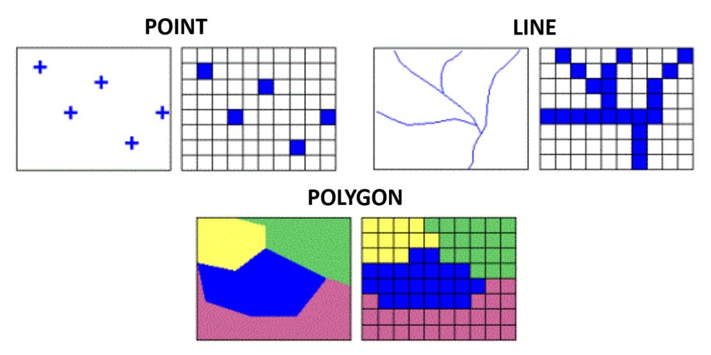{ width=600px }
  <figcaption>Difference in graphical representation of vector and raster data (Geletič et al. 2019)</figcaption>
</figure>

### Basic terms

* [**Raster data**](https://pro.arcgis.com/en/pro-app/latest/help/data/imagery/what-is-raster-data.htm) – spatial data represented as a matrix of cells or pixels.
* [**Pixel / cell**](https://pro.arcgis.com/en/pro-app/latest/help/data/imagery/cell-size-of-raster-data.htm) – the basic spatial element of a raster. Each cell stores one value per raster band.
* **Spatial resolution / cell size** – the ground size represented by one raster cell. A raster with a cell size of 2 m contains more spatial detail than a raster with a cell size of 100 m.
* [**Resampling**](https://pro.arcgis.com/en/pro-app/latest/help/analysis/raster-functions/resample-function.htm) – changing the spatial resolution or alignment of a raster. Common methods include Nearest Neighbor, Bilinear Interpolation and Cubic Convolution.
* **Bit** – the smallest unit of digital information; it can have a value of `0` or `1`.
* [**Pixel depth / bit depth**](https://pro.arcgis.com/en/pro-app/latest/help/data/imagery/bit-depth-capacity-for-raster-dataset-cells.htm) – the number of bits used to store the value of one cell in one band. Bit depth determines the range of possible cell values. For example, an unsigned 8-bit raster can store \(2^8 = 256\) values (`0–255`), while an unsigned 16-bit raster can store `0–65,535`.
* **Pixel type / data type** – specifies how raster values are stored, for example unsigned integer, signed integer or floating point. Continuous elevation data are frequently stored as floating-point values.
* [**Band**](https://pro.arcgis.com/en/pro-app/latest/help/data/imagery/gathering-basic-raster-dataset-information-pro-.htm) – one spatially coincident layer within a raster dataset. A grayscale raster usually contains one band; an RGB image contains three bands (red, green, blue), while multispectral satellite imagery may contain many bands covering different wavelength ranges.
* **NoData** – a special raster value indicating that no valid information is available for a cell.
* [**Raster pyramids**](https://pro.arcgis.com/en/pro-app/latest/help/data/imagery/raster-pyramids.htm) – lower-resolution copies of raster data used to speed up visualization at smaller map scales.
* **Continuous raster** – raster whose values represent a continuously varying phenomenon, such as elevation or temperature.
* **Categorical raster** – raster whose cell values represent discrete classes, such as land cover categories.

!!! tip
    Basic information about a raster dataset can be found in ArcGIS Pro under **Layer Properties → Source → Raster Information**, where you can inspect cell size, number of bands, pixel type, bit depth, NoData value and other properties.

---

### Common types of raster data

Raster data can represent measured values, images, classified thematic data, or surfaces derived from other datasets.

-   :material-elevation-rise:{ .lg .middle height} __Digital Elevation Model__

    ---

    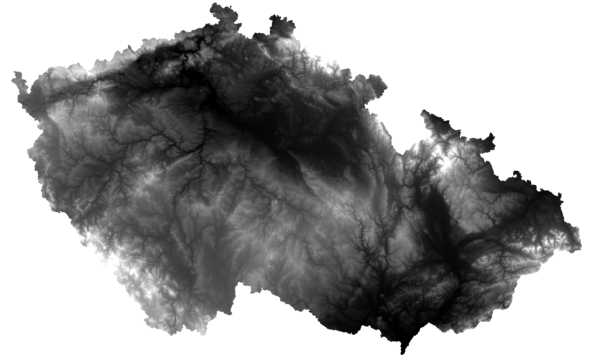

    *[__Digital Elevation Model (DEM)__](https://pro.arcgis.com/en/pro-app/3.6/tool-reference/spatial-analyst/exploring-digital-elevation-models.htm) represents elevation values. Each cell contains an elevation value for a particular location.*

-   :material-terrain:{ .lg .middle } __Hillshade__

    ---

    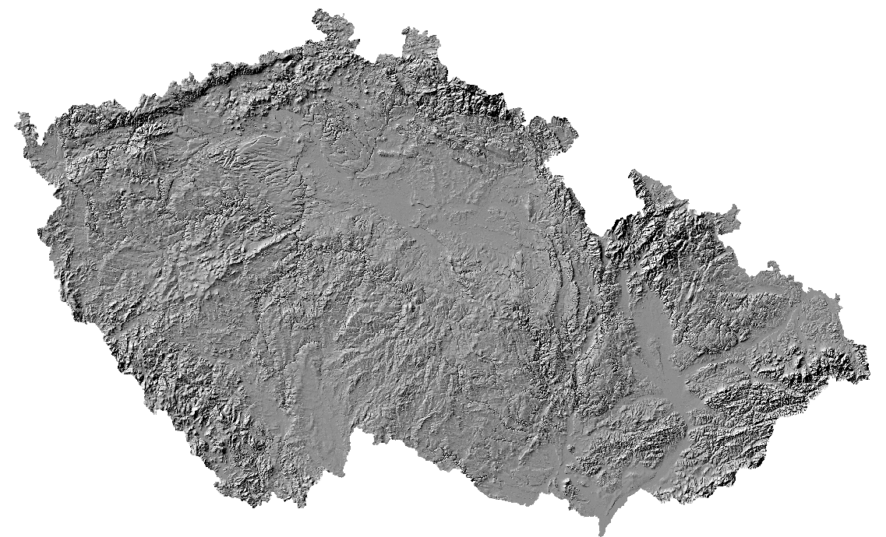

    *[__Hillshade__](https://pro.arcgis.com/en/pro-app/latest/tool-reference/spatial-analyst/hillshade.htm) is a raster derived from an elevation model. It simulates illumination of the terrain from a specified direction and creates the visual impression of relief.*

-   :material-map:{ .lg .middle } __scanned map__

    ---
    

    *A __scanned map__ is a digital image of an analogue map. It is usually a single-band or RGB raster. To use it together with other GIS data, it generally needs to be [**georeferenced**](https://k155cvut.github.io/gise/practicals/georeferencing_vectorization/).*

-   :material-airplane:{ .lg .middle } __orthophoto__

    ---
    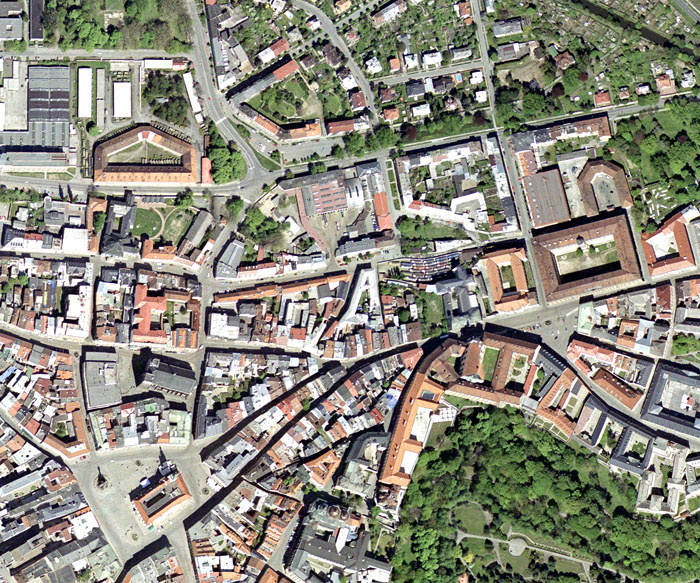

    *An [__orthophoto__](https://data.europa.eu/data/datasets/ortofoto-21?locale=en) is an aerial photograph that has been geometrically corrected so that distances and positions can be measured similarly to a map.*

-   :fontawesome-solid-satellite:{ .lg .middle } __satellite imagery__

    ---
    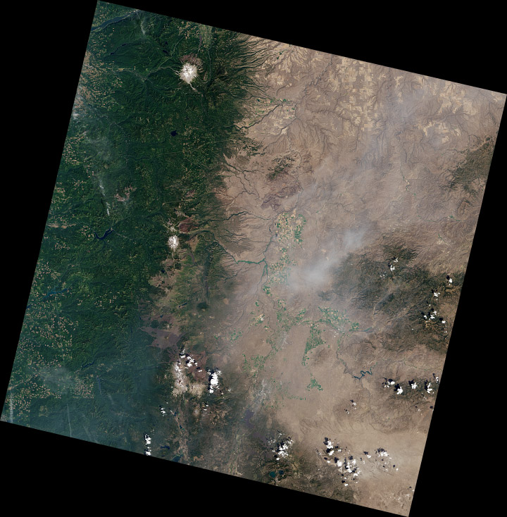

    *[__Satellite imagery__](https://www.esri.com/en-us/arcgis/products/unlock-earths-secrets) usually consists of several spectral bands. Different combinations of bands can be used to create natural-colour or false-colour images and to derive information about vegetation, water, soil, built-up areas and other phenomena.*

-   :material-grid:{ .lg .middle } __categorical thematic raster__

    ---
    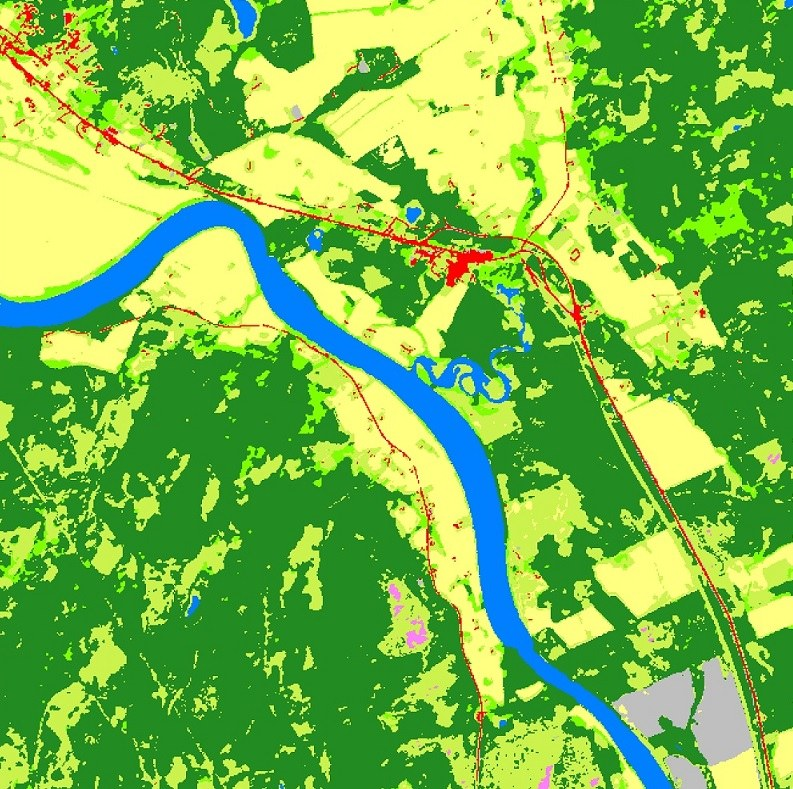

    *[__CORINE Land Cover (CLC)__](https://land.copernicus.eu/en/products/corine-land-cover) is an example of __a categorical thematic raster__. Each raster cell contains a code representing a land cover / land use category.*

## Digital Elevation Models (DEM)

A **Digital Elevation Model (DEM)** is a digital representation of elevation. The term is often used as a general term for digital representations of terrain or surface height.

Two important types of elevation models are:

| Model | Meaning | Represents | Buildings and vegetation | GIS Application
| --- | --- | --- | --- | --- |
| **DTM** | Digital Terrain Model | bare-earth terrain surface | removed | hydrological modelling, slope analysis, geomorphology, engineering, flood modelling, terrain profiles |
| **DSM** | Digital Surface Model | top surface visible to the sensor | included | visibility analysis in urban areas, building-height studies, solar potential, vegetation structure, 3D city modelling |

<figure markdown>
  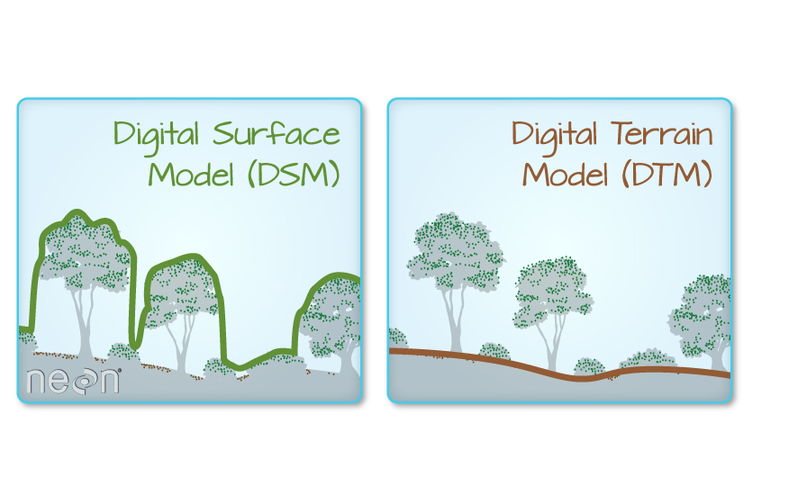{ width=600px }
  <figcaption>The difference between DSM, and DTM   (Source: (https://www.neonscience.org/resources/learning-hub/tutorials/chm-dsm-dtm)</figcaption>
</figure>

!!! note
    Terminology is not completely standardised between data providers. Always check the metadata of a particular elevation product to determine what the dataset actually represents.

### How are elevation data acquired?

Elevation data can be collected using several methods:

* **ground surveying / GNSS** – direct measurement of elevations at individual locations;
* **photogrammetry** – extraction of 3D information from overlapping aerial or satellite images;
* **LiDAR / laser scanning** – laser pulses are used to measure distances to the Earth's surface and objects above it; the result is usually a dense point cloud;
* **radar interferometry (InSAR)** – elevation is derived from differences between radar observations, for example in the SRTM mission;
* **digitised contour lines and spot heights** – existing cartographic elevation information can be converted into a continuous elevation surface using interpolation.

<iframe width="560" height="315" src="https://www.youtube.com/embed/tywhaVH3l9Y?si=OlRi_tEgdFa5kueI" title="YouTube video player" frameborder="0" allow="accelerometer; autoplay; clipboard-write; encrypted-media; gyroscope; picture-in-picture; web-share" referrerpolicy="strict-origin-when-cross-origin" allowfullscreen></iframe>

### Common elevation-data representations

-   :material-grid:{ .lg .middle } **__Raster__**

    ---
    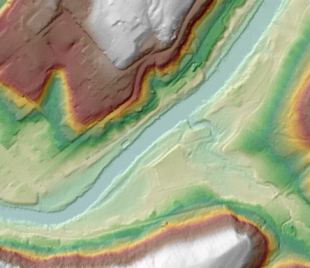{: style="width: 400px; height: 400px; object-fit: cover; display: block; margin: 0 auto;" }

    A **raster DEM** is a regular grid where each cell contains an elevation value.

    Typical formats include **GeoTIFF**, Esri raster datasets and Cloud Optimized GeoTIFFs (COG).

    Raster DEMs are particularly convenient for terrain analysis because many algorithms operate directly on neighbouring cells.

-   :material-dots-grid:{ .lg .middle } **__LiDAR point cloud__**

    ---

    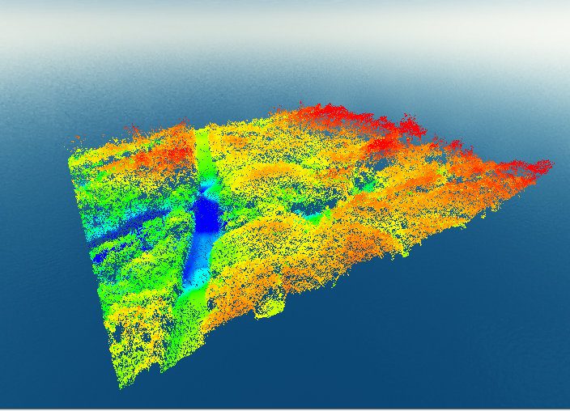{: style="width: 400px; height: 400px; object-fit: cover; display: block; margin: 0 auto;" }

    A **LiDAR point cloud** is a large collection of points with X, Y and Z coordinates acquired by laser scanning.

    Common formats are **LAS** and compressed **LAZ**.

    Point clouds may contain classifications distinguishing ground, vegetation, buildings and other objects. A **DTM** or **DSM** can subsequently be derived from the point cloud.

-   :material-vector-triangle:{ .lg .middle } **__TIN__**

    ---

    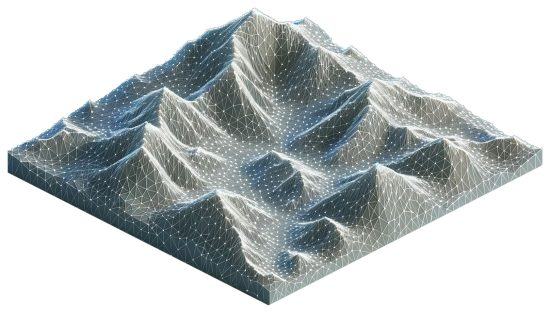{: style="width: 400px; height: 400px; object-fit: cover; display: block; margin: 0 auto;" }

    A **Triangulated Irregular Network (TIN)** represents a surface using non-overlapping triangles connecting irregularly distributed elevation points.

    TINs can efficiently preserve important terrain breaklines and changes in relief while using a variable density of points.

-   :material-vector-polyline:{ .lg .middle } **__Vector elevation data__**

    ---

    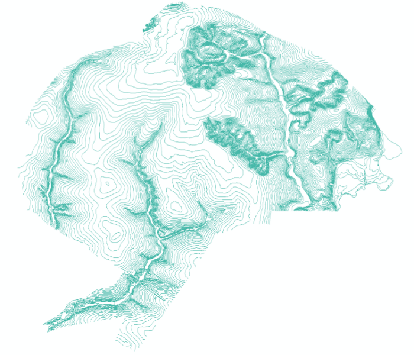{: style="width: 400px; height: 400px; object-fit: cover; display: block; margin: 0 auto;" }

    Elevation can also be stored as **contour lines**, **spot heights**, breaklines or other vector features.

    A continuous elevation model can be created from these data using **interpolation**.

---

### Where can you find DEM data?

Several global, European and national portals provide elevation data. Always check **spatial resolution, vertical accuracy, reference system, acquisition method and whether the dataset represents a DTM or DSM** before using it.

* [GIS Geography – Free Global DEM Data Sources](https://gisgeography.com/free-global-dem-data-sources/) – overview of several global DEM products, including SRTM and ASTER.
* [OpenDEM](https://www.opendem.info/) – portal and search tools for freely available elevation datasets from different countries.
* [Copernicus DEM](https://dataspace.copernicus.eu/explore-data/data-collections/copernicus-contributing-missions/collections-description/COP-DEM) – global Copernicus Digital Elevation Model products.
* [USGS EarthExplorer](https://earthexplorer.usgs.gov/) – access to SRTM and other elevation datasets.
* [ČÚZK Geoportal](https://geoportal.cuzk.cz/) – detailed elevation data for Czechia, including DMR and DMP products.

## Terrain analysis

**Terrain analysis** refers to GIS methods used to describe and interpret the shape of the Earth's surface. Most terrain-analysis tools use a DEM as input and calculate new raster values from the elevation and the spatial relationships between neighbouring cells.

Typical outputs include slope, aspect, curvature, hillshade and visibility.

<!--

=== "*slope*"

    [**SLOPE**](https://pro.arcgis.com/en/pro-app/latest/tool-reference/spatial-analyst/slope.htm) 
    Calculates the **steepness of the terrain** for each raster cell. The result can be expressed in **degrees** or **percent rise**.

    Low values represent flat terrain; high values represent steep slopes.

    

    <figcaption markdown>
    source: [Slope – ArcGIS Pro](https://pro.arcgis.com/en/pro-app/latest/tool-reference/spatial-analyst/slope.htm)
    </figcaption>

=== "*aspect*"

    [**ASPECT**](https://pro.arcgis.com/en/pro-app/latest/tool-reference/spatial-analyst/aspect.htm) 
    Calculates the **compass direction of the steepest downhill slope** for each cell.

    Aspect is normally expressed in degrees from `0°` to `360°`, measured clockwise from north. Flat cells have no downslope direction.

    

    <figcaption markdown>
    source: [Aspect – ArcGIS Pro](https://pro.arcgis.com/en/pro-app/latest/tool-reference/spatial-analyst/aspect.htm)
    </figcaption>

=== "*hillshade*"

    [**HILLSHADE**](https://pro.arcgis.com/en/pro-app/latest/tool-reference/spatial-analyst/hillshade.htm) 
    Creates a **shaded-relief raster** by modelling illumination from a specified azimuth and altitude.

    Hillshade is mainly a visualisation technique. Output values usually range from `0` (darkest) to `255` (brightest).

    

    <figcaption markdown>
    source: [Hillshade – ArcGIS Pro](https://pro.arcgis.com/en/pro-app/latest/tool-reference/spatial-analyst/hillshade.htm)
    </figcaption>

=== "*viewshed*"

    [**VIEWSHED**](https://pro.arcgis.com/en/pro-app/latest/tool-reference/spatial-analyst/viewshed.htm) 
    Determines which locations on a surface are **visible from one or more observer locations**.

    The output raster records visibility of individual cells. Visibility results depend on the elevation model, observer height and other analysis parameters.

    

    <figcaption markdown>
    source: [Viewshed – ArcGIS Pro](https://pro.arcgis.com/en/pro-app/latest/tool-reference/spatial-analyst/viewshed.htm)
    </figcaption>

=== "*curvature*"

    [**SURFACE PARAMETERS / CURVATURE**](https://pro.arcgis.com/en/pro-app/latest/tool-reference/spatial-analyst/surface-parameters.htm) 
    Describes how the surface bends. Curvature can help identify convex and concave parts of the terrain and is useful in geomorphology, hydrology and erosion studies.

=== "*contours*"

    [**CONTOUR**](https://pro.arcgis.com/en/pro-app/latest/tool-reference/spatial-analyst/contour.htm) 
    Creates contour lines connecting locations of equal elevation. Contours provide a vector representation of the shape and elevation of the terrain.

-->

!!! info
    ArcGIS Pro also provides the **Surface Parameters** tool, which offers newer implementations of slope, aspect and curvature calculations and allows the analysis neighbourhood to be adjusted. The traditional **Slope** and **Aspect** tools are still widely used and are used in this assignment.

**Learn more:**
{: align=center }

[pro.arcgis.com How Surface Parameters works](https://pro.arcgis.com/en/pro-app/latest/tool-reference/3d-analyst/how-surface-parameters-works.htm){ .md-button .md-button--primary .server_name .external_link_icon_small target="_blank"}
{: .button_array}

## Reclassification and map algebra

### Reclassification

[**Reclassify**](https://pro.arcgis.com/en/pro-app/latest/tool-reference/spatial-analyst/reclassify.htm) replaces ranges or individual raster values with new values.

For example, a slope raster can be converted into two categories:

* `0` – slope does not meet the criterion,
* `1` – slope meets the criterion.

Reclassification is useful when several different raster criteria need to be combined in a model.

### Map algebra

**Map algebra** is a framework for performing cell-by-cell operations on raster data. It allows multiple raster layers to be combined using mathematical expressions, logical conditions and raster functions.

For example, if several reclassified raster layers contain only `0` and `1`, they can be multiplied to identify locations where **all criteria are satisfied simultaneously**.

[**Raster Calculator**](https://pro.arcgis.com/en/pro-app/latest/tool-reference/spatial-analyst/raster-calculator.htm) provides an interface for writing map-algebra expressions in ArcGIS Pro.

!!! note
    Raster layers used together in map algebra should ideally have the same **coordinate system, cell size, extent and cell alignment**. Analysis environment settings such as **Snap Raster**, **Cell Size** and **Processing Extent** can be used to control these properties.

**Learn more:**
{: align=center }

[pro.arcgis.com Introduction to map algebra](https://pro.arcgis.com/en/pro-app/3.4/help/analysis/spatial-analyst/mapalgebra/what-is-map-algebra.htm){ .md-button .md-button--primary .server_name .external_link_icon_small target="_blank"}
{: .button_array}

## Interpolation

**Interpolation** estimates unknown values at unsampled locations using values measured at known locations. In GIS, interpolation is commonly used to create continuous raster surfaces from point measurements such as elevation, temperature, precipitation, pollution or wind speed.

**Extrapolation** refers to estimating values outside the area covered by the input observations.

### Interpolation methods

-   :material-chart-scatter-plot:{ .lg .middle } **__IDW__ (Inverse Distance Weighted)** 

    

    The cell value is calculated as a weighted average of surrounding points, with the weight decreasing with distance according to a power function (parameter *_Power_*). It does not create values outside the range of the input data, so it cannot reproduce peaks or valley bottoms unless a sample point is located there. Typical “bull's-eye” patterns may form around input points.

    [pro.arcgis.com How IDW works](https://pro.arcgis.com/en/pro-app/latest/tool-reference/3d-analyst/how-idw-works.htm){ .md-button .md-button--primary .server_name .external_link_icon_small target="_blank"}
    {: .button_array}

-   :material-vector-curve:{ .lg .middle } **__Spline__**

    

    Fits a smooth surface through the input points while minimizing surface curvature. The result is smooth and may exceed the range of the input values. The *_Regularized_* type creates a more flexible surface, while *_Tension_* produces a flatter surface. It is not suitable where nearby points have very different values.

    [pro.arcgis.com How Spline works](https://pro.arcgis.com/en/pro-app/latest/tool-reference/3d-analyst/how-spline-works.htm){ .md-button .md-button--primary .server_name .external_link_icon_small target="_blank"}
    {: .button_array}

-   :material-hexagon-multiple-outline:{ .lg .middle } **__Natural Neighbor__**

    

    Derives weights from the overlap of Thiessen (Voronoi) polygons. It uses only the nearest surrounding points, is a local method, and has very few parameters.

    [pro.arcgis.com How Natural Neighbor works](https://pro.arcgis.com/en/pro-app/latest/tool-reference/3d-analyst/how-natural-neighbor-works.htm){ .md-button .md-button--primary .server_name .external_link_icon_small target="_blank"}
    {: .button_array}

-   :material-chart-bell-curve:{ .lg .middle } **__Kriging__**

    

    A geostatistical method. The weights depend both on distance and on the spatial autocorrelation of the data, described by a semivariogram. For most datasets, *_Ordinary Kriging_* is a suitable default choice.

    [pro.arcgis.com How Kriging works](https://pro.arcgis.com/en/pro-app/latest/tool-reference/3d-analyst/how-kriging-works.htm){ .md-button .md-button--primary .server_name .external_link_icon_small target="_blank"}
    {: .button_array}

!!! tip
    There is no universally "best" interpolation method. The appropriate method depends on the phenomenon, point density and distribution, spatial autocorrelation, required accuracy and intended use of the output.

<!-- ## Basic terms

  

    <strong>Terrain Analysis</strong>
    

    
 <strong>Terrain analysis</strong>  refers to a set of GIS techniques used to describe and interpret the shape of the Earth’s surface. By deriving information such as slope, aspect or curvature from a digital elevation model, terrain analysis helps us understand how topography influences natural processes, accessibility, visibility and spatial patterns in the landscape.

  

   
  

    <strong>Map algebra</strong>
    

    
 <strong>Map algebra</strong> is a framework for performing cell-by-cell operations on raster data. It allows users to combine multiple raster layers using mathematical expressions, logical conditions or statistical functions. Through map algebra, it becomes possible to model environmental suitability, classify risk zones or derive new thematic layers from existing datasets.

  

   
  

    <strong>Interpolation</strong>
    

    
 <strong>Interpolation</strong> is a method used to estimate unknown values at unsampled locations based on measurements taken at known points. In GIS, interpolation creates continuous surfaces — such as elevation, temperature or pollution concentration — from discrete observations. This helps reveal spatial gradients and provides input for further spatial analyses.

  

 
-->

**Learn more:**
{: align=center }

[pro.arcgis.com Understanding interpolation analysis](https://pro.arcgis.com/en/pro-app/latest/tool-reference/spatial-analyst/understanding-interpolation-analysis.htm){ .md-button .md-button--primary .server_name .external_link_icon_small target="_blank"}
[pro.arcgis.com An introduction to interpolation methods](https://pro.arcgis.com/en/pro-app/latest/help/analysis/geostatistical-analyst/an-introduction-to-interpolation-methods.htm){ .md-button .md-button--primary .server_name .external_link_icon_small target="_blank"}
[pro.arcgis.com Comparing interpolation methods](https://pro.arcgis.com/en/pro-app/latest/tool-reference/spatial-analyst/comparing-interpolation-methods.htm){ .md-button .md-button--primary .server_name .external_link_icon_small target="_blank"}
{: .button_array}

## Assignment 05
!!! abstract "Areas of avalanche risk in the Krkonoše National Park"
    **TASK:**

    Based on the analysis of provided data, make a map showing the areas of avalanche risk in [the Krkonoše National Park](https://en.wikipedia.org/wiki/Krkono%C5%A1e_National_Park){target="_blank"}. In the map, distinguish the areas according to their level of avalanche risk (0-none, 1-very low, 2-low, 3-medium, 4-high).

    Areas of the avalanche risk are defined according to the following criteria:

    1. elevation
    
        - the highest third of the national pak

    2. slope/inclination
    
        - more than 30°

    3. land cover
    
        - land cover code = 2.X.X or 3.X.X (except for 3.1.1, 3.1.2, and 3.1.3)

    4. wind speed
    
        - windier half of the national park

     
    In a map poster answer following questions:
    
    - What proportion of the Krkonoše National Park (in %) lies within the zone of high risk of avalanches (i.e. the sum of all criteria is 4)?
    - What proportion of the Krkonoše National Park (in %) lies outside the avalanche-risk zone (i.e. the sum of all criteria is 0)?

     
    **DATA SOURCES:**

    - [Digital elevation model (DEM)](https://pro.arcgis.com/en/pro-app/latest/tool-reference/spatial-analyst/exploring-digital-elevation-models.htm){target="_blank"}

    - Wind speed measurement

    - [Corine Land Cover (CLC)](https://land.copernicus.eu/pan-european/corine-land-cover){target="_blank"}

    - Czechia protected land areas

        
      [:material-download: Data for avalanche risk map :material-layers:](../assets/TerrainAnalysis/AvalancheRisk.gdb.zip){ .md-button .md-button--primary .button_smaller }
        {: .button_array style="justify-content:flex-start;"}

    **SUBMISSION FORM:**

    - map poster in PDF format (submit by 29/11, send to <a href="mailto:petra.justova@fsv.cvut.cz">petra.justova@fsv.cvut.cz</a>)

     

    **INSTRUCTIONS:**

    **1. Explore input data**

    - First of all, it’s always essential to start with exploring input data, understand the data types or browse the attribute tables for instance.
            
        - ``DMR`` is a raster which stores values of height above sea level for the area of Czechia.

        - ``CzechProtected`` is a polygon feature layer containing polygons of parts of the Krkonoše National Park.

        - ``windSpeed`` is a point feature layer of measurement units in Czechia with average measured wind speed.

        - ``CORINE`` is a classified raster including many land cover and land use classes.

    **2. Data Preparation**

    - Clip both rasters to the extent of Krkonoše National Park *(Extract by Mask)*

    **3. Terrain Analysis**

    - In the following step, a set of spatial analysis tools together with subsequent reclassification will be processed to calculate and classify elevation and slope (steepness). Later on, you will deal with reclassification of Corine Land Cover raster and finally, suitable interpolation method will be used to help you process wind speed data.

    - Use Slope function to calculate the steepness. Use extracted raster by your national park as an input raster. The output should be similar to following picture.

        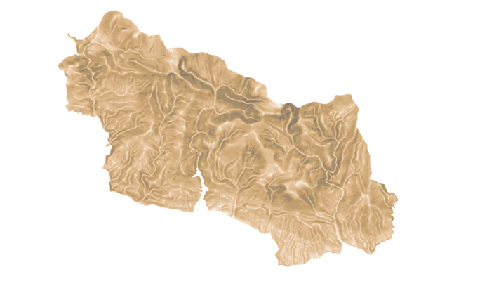{ .no-filter .off-glb}
        {: align=center}
        
    - Use Reclassify tool to change the values in slope raster. Basically, you’re interested in two categories: 0°–30° and 30°–90° so you can define new values: 0 and 1. Zero stands for “doesn’t meet the criteria”.

        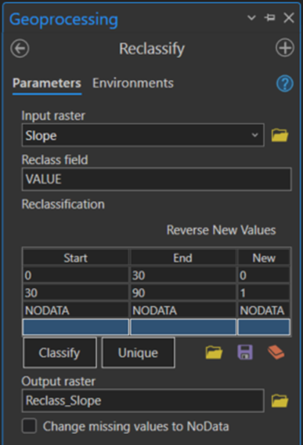{ .no-filter .off-glb}
        {: align=center}
        
    - Similarly you need to reclassify your extracted DEM to decide, which values are within the highest third of national park. In Krkonoše national park, the highest third is indicated by violet color (see the picture below).

        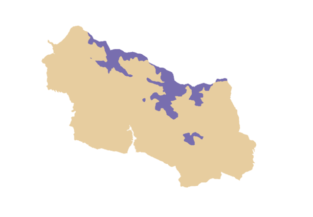{ .no-filter .off-glb}
        {: align=center}
        
    - By this time, you should have two reclassified raster layers (elevation and slope). Now it’s time to do the same with CORINE Land Cover data. Such raster reclassification might look a little bit sophisticated since you have to discover and use the land cover codes in the attribute table. The criteria in the assignment are clear enough so it is going to be an easy job anyway. For more detail on the land cover classification see [CLC illustrated nomenclature guidelines](https://land.copernicus.eu/content/corine-land-cover-nomenclature-guidelines/docs/pdf/CLC2018_Nomenclature_illustrated_guide_20190510.pdf){target="_blank"}

    - If you were successful to reclassify three raster layers, you can move to wind speed feature layer. You’ve processed only raster data so far. Since you need to use raster calculator in the very ending, your final outputs have to be raster layers, so it is necessary to “transform” a point layer using some math into a raster (continuous surface).

        !!! note-grey "Note"

            “Interpolation predicts values for cells in a raster from a limited number of sample data points. It can be used to predict unknown values for any geographic point data, such as elevation, rainfall, chemical concentrations, and noise levels.” (pro.arcgis.com)

    - Using some of the links above, you can compare interpolation methods and choose the best one (or at least suitable) for point data. For this purpose, Inverse distance weighing (IDW) looks promising. Fill speed attribute as a Z field value and don’t forget to define an Output cell size (should be consistent for all your raster layers).

    - The output should be calculated for entire Czech Republic and clipped by national park polygon subsequently (if you first clip than interpolate, your result won’t be accurate)

    - Afterwards, the last reclassification is ahead: you have to detect a windier part of assigned national park

    **4. Combine the criteria and find out the result!** 

    - Now is time for the best part of solution: combining the reclassified raster layers and finding out risky areas. All you need is to use Raster Calclulator and compile an appropriate algebraic expression. Your raster layers include only values of 0 and 1. As it’s mentioned above, zero is against the criteria. The final question is, how to construct four values as an algebra expression so the resulting raster layer would consist of values 0 and 1 again and zero would stand for “safe” slopes? Zero will represent for example an area in windier part & lower half of national park or area in the highest third of national park & having land cover code 1.2.1.

        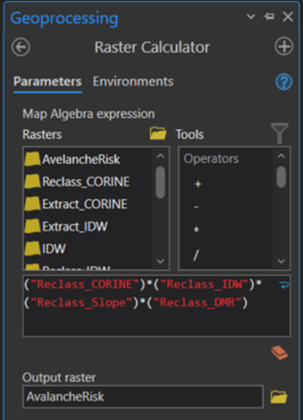{ .no-filter .off-glb}
        {: align=center}

    - Avalanche risk in national park Krkonoše is red-colored in the picture below. It is possible to make the final raster semi-transparent and set Czech orthophoto as a background map to better illustrate the result for instance.

        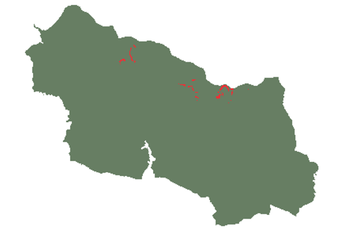{ .no-filter .off-glb}
        {: align=center}

    - Another approach could be represented by symbolizing different levels of avalanche risk, which can be reached if you change the expression in raster calculator. Instead of multiplying the values of four raster layers, you can simply sum them up. Output will consist of 5 different values: 0, 1, 2, 3, or 4. Change raster symbology afterwards to indicate increasing avalanche risk according to the that values.

    **5. Visualize the results**

    - Set the symbolization of all different levels of avalanche risk properly (0-none, 1-very low, 2-low, 3-medium, 4-high). 
    - In *New Layout* (A4 Landscape) insert the Map Title, Scale and Credits.
    - Export *Layout* in PDF Format.

 
