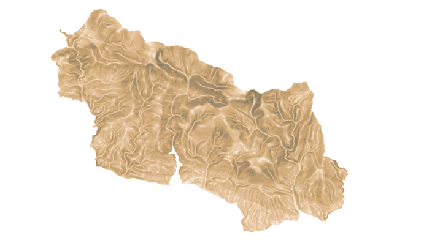
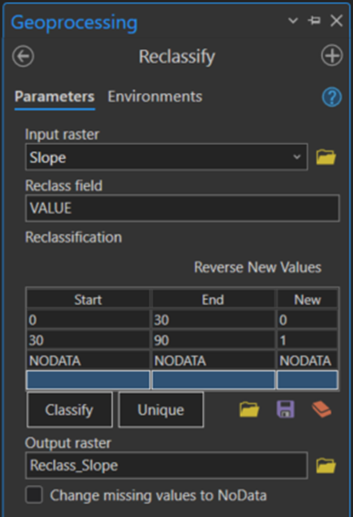
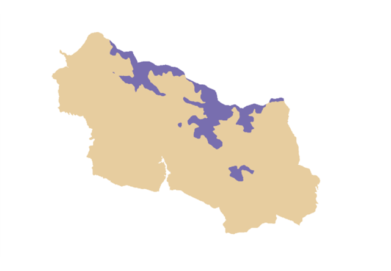
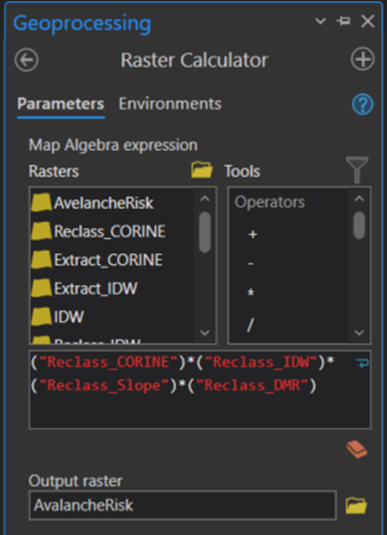
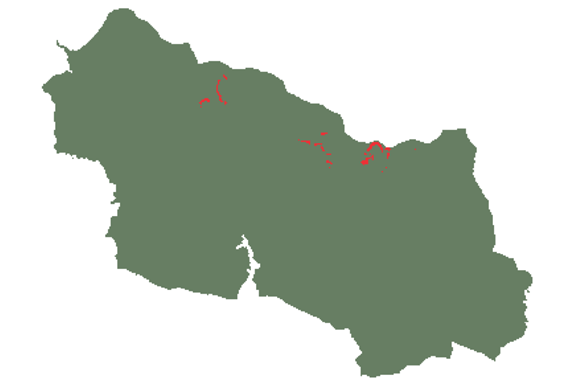

# Terrain analysis, raster data and map algebra

In this practical, we will focus on **raster data**, **digital elevation models (DEM)**, basic **terrain analysis**, **interpolation**, and **map algebra**. These concepts are widely used in environmental modelling, hydrology, landscape analysis, visibility studies, risk assessment, and many other GIS applications.

The practical combines a short theoretical introduction with **Assignment 05 – Areas of avalanche risk in the Krkonoše National Park**.

---

<hr class="level-1">

## Raster data – basic concepts

A **raster** is a data structure composed of cells arranged in rows and columns. Each cell stores a value representing a phenomenon at a particular location.

Raster data are especially suitable for representing **continuous phenomena** such as elevation, temperature, rainfall, or pollution, but they can also represent **categorical information** such as land cover classes.

* [**Raster data**](https://pro.arcgis.com/en/pro-app/latest/help/data/imagery/what-is-raster-data.htm) – spatial data represented as a matrix of cells or pixels.
* [**Pixel / cell**](https://pro.arcgis.com/en/pro-app/latest/help/data/imagery/cell-size-of-raster-data.htm) – the basic spatial element of a raster. Each cell stores one value per raster band.
* **Spatial resolution / cell size** – the ground size represented by one raster cell. A raster with a cell size of 2 m contains more spatial detail than a raster with a cell size of 100 m.
* [**Resampling**](https://pro.arcgis.com/en/pro-app/latest/help/analysis/raster-functions/resample-function.htm) – changing the spatial resolution or alignment of a raster. Common methods include Nearest Neighbor, Bilinear Interpolation and Cubic Convolution.
* **Bit** – the smallest unit of digital information; it can have a value of `0` or `1`.
* [**Pixel depth / bit depth**](https://pro.arcgis.com/en/pro-app/latest/help/data/imagery/bit-depth-capacity-for-raster-dataset-cells.htm) – the number of bits used to store the value of one cell in one band. Bit depth determines the range of possible cell values. For example, an unsigned 8-bit raster can store \(2^8 = 256\) values (`0–255`), while an unsigned 16-bit raster can store `0–65,535`.
* **Pixel type / data type** – specifies how raster values are stored, for example unsigned integer, signed integer or floating point. Continuous elevation data are frequently stored as floating-point values.
* [**Band**](https://pro.arcgis.com/en/pro-app/latest/help/data/imagery/gathering-basic-raster-dataset-information-pro-.htm) – one spatially coincident layer within a raster dataset. A grayscale raster usually contains one band; an RGB image contains three bands (red, green, blue), while multispectral satellite imagery may contain many bands covering different wavelength ranges.
* **NoData** – a special raster value indicating that no valid information is available for a cell.
* [**Raster pyramids**](https://pro.arcgis.com/en/pro-app/latest/help/data/imagery/raster-pyramids.htm) – lower-resolution copies of raster data used to speed up visualization at smaller map scales.
* **Continuous raster** – raster whose values represent a continuously varying phenomenon, such as elevation or temperature.
* **Categorical raster** – raster whose cell values represent discrete classes, such as land cover categories.

!!! tip
    Basic information about a raster dataset can be found in ArcGIS Pro under **Layer Properties → Source → Raster Information**, where you can inspect cell size, number of bands, pixel type, bit depth, NoData value and other properties.

---

## Common types of raster data

Raster data can represent measured values, images, classified thematic data, or surfaces derived from other datasets.


<div class="centered_tab_labels gallery-tabs" markdown>

=== "*DEM*"

    **Digital Elevation Model (DEM)** represents elevation values. Each cell contains an elevation value for a particular location.

    

    <figcaption markdown>
    source: [GIS Geography – Free Global DEM Data Sources](https://gisgeography.com/free-global-dem-data-sources/)
    </figcaption>

=== "*hillshade*"

    **Hillshade** is a raster derived from an elevation model. It simulates illumination of the terrain from a specified direction and creates the visual impression of relief.

    

    <figcaption markdown>
    source: [Hillshade – ArcGIS Pro](https://pro.arcgis.com/en/pro-app/latest/tool-reference/spatial-analyst/hillshade.htm)
    </figcaption>

=== "*scanned map*"

    A **scanned map** is a digital image of an analogue map. It is usually a single-band or RGB raster. To use it together with other GIS data, it generally needs to be **georeferenced**.

    Example: [historical scanned topographic map – Wikimedia Commons](https://commons.wikimedia.org/wiki/File:Sheet_446._Hirschfelde_(Bohmen)._Herausgegeben_vom_topogr._Bureau_des_Konigl._Sachs._Generalstabes._Karte_des_Deutschen_Reiches._(IA_dr_sheet-446-hirschfelde-bohmen-herausgegeben-vom-topogr-bureau-des-konig-5820446).jpg)

=== "*orthophoto*"

    An **orthophoto** is an aerial photograph that has been geometrically corrected so that distances and positions can be measured similarly to a map.

    Orthophotos are commonly used as detailed background imagery for mapping, change detection, digitising and visual interpretation.

    Example source: [ČÚZK Geoportal / orthophoto](https://geoportal.cuzk.cz/)

=== "*satellite imagery*"

    **Satellite imagery** usually consists of several spectral bands. Different combinations of bands can be used to create natural-colour or false-colour images and to derive information about vegetation, water, soil, built-up areas and other phenomena.

    Example source: [Copernicus Browser](https://browser.dataspace.copernicus.eu/)

=== "*CLC raster*"

    **CORINE Land Cover (CLC)** is an example of a **categorical thematic raster**. Each raster cell contains a code representing a land cover / land use category.

    CLC provides a harmonised pan-European inventory with **44 thematic classes**. CLC 2018 is available both as vector data and as a **100 m raster**.

    Example: [CORINE Land Cover 2018 – map and download](https://land.copernicus.eu/en/products/corine-land-cover/clc2018?tab=mapview)

</div>

---

## Digital Elevation Models (DEM)

A **Digital Elevation Model (DEM)** is a digital representation of elevation. The term is often used as a general term for digital representations of terrain or surface height.

Two important types of elevation models are:

| Model | Meaning | Represents | Buildings and vegetation |
| --- | --- | --- | --- |
| **DTM** | Digital Terrain Model | bare-earth terrain surface | removed |
| **DSM** | Digital Surface Model | top surface visible to the sensor | included |

### DTM vs. DSM

A **DTM** represents the elevation of the ground surface. Buildings, trees and other objects above the ground are removed as far as possible.

A **DSM** represents the uppermost surface detected by the sensor. It therefore includes buildings, tree canopies and other objects above the ground.

!!! note
    Terminology is not completely standardised between data providers. Always check the metadata of a particular elevation product to determine what the dataset actually represents.

Typical applications:

* **DTM** – hydrological modelling, slope analysis, geomorphology, engineering, flood modelling, terrain profiles.
* **DSM** – visibility analysis in urban areas, building-height studies, solar potential, vegetation structure, 3D city modelling.

[**Illustrated DTM / DSM comparison – ArcGIS Pro**](https://pro.arcgis.com/en/pro-app/latest/help/data/imagery/generate-elevation-data-using-the-dems-wizard.htm)

### How are elevation data acquired?

Elevation data can be collected using several methods:

* **ground surveying / GNSS** – direct measurement of elevations at individual locations;
* **photogrammetry** – extraction of 3D information from overlapping aerial or satellite images;
* **LiDAR / laser scanning** – laser pulses are used to measure distances to the Earth's surface and objects above it; the result is usually a dense point cloud;
* **radar interferometry (InSAR)** – elevation is derived from differences between radar observations, for example in the SRTM mission;
* **digitised contour lines and spot heights** – existing cartographic elevation information can be converted into a continuous elevation surface using interpolation.

### Common elevation-data representations

Elevation information can be distributed in several forms:

=== "*raster*"

    A regular grid where each cell contains an elevation value.

    Typical formats include **GeoTIFF**, Esri raster datasets and cloud-optimised GeoTIFFs.

    Raster DEMs are particularly convenient for terrain analysis because many algorithms operate directly on neighbouring cells.

=== "*LiDAR point cloud*"

    A large collection of points with X, Y and Z coordinates acquired by laser scanning.

    Common formats are **LAS** and compressed **LAZ**.

    Point clouds may contain classifications distinguishing ground, vegetation, buildings and other objects. A DTM or DSM can subsequently be derived from the point cloud.

=== "*TIN*"

    A **Triangulated Irregular Network (TIN)** represents a surface by non-overlapping triangles connecting irregularly distributed elevation points.

    TINs can efficiently preserve important terrain breaklines and changes in relief while using a variable density of points.

=== "*vector elevation data*"

    Elevation can also be stored as **contour lines**, **spot heights**, breaklines or other vector features. A continuous elevation model can be created from these data using interpolation.

---

### Where can you find DEM data?

Several global, European and national portals provide elevation data. Always check **spatial resolution, vertical accuracy, reference system, acquisition method and whether the dataset represents a DTM or DSM** before using it.

* [GIS Geography – Free Global DEM Data Sources](https://gisgeography.com/free-global-dem-data-sources/) – overview of several global DEM products, including SRTM and ASTER.
* [OpenDEM](https://www.opendem.info/) – portal and search tools for freely available elevation datasets from different countries.
* [Copernicus DEM](https://dataspace.copernicus.eu/explore-data/data-collections/copernicus-contributing-missions/collections-description/COP-DEM) – global Copernicus Digital Elevation Model products.
* [USGS EarthExplorer](https://earthexplorer.usgs.gov/) – access to SRTM and other elevation datasets.
* [ČÚZK Geoportal](https://geoportal.cuzk.cz/) – detailed elevation data for Czechia, including DMR and DMP products.

[**Video: introduction to digital elevation models**](https://www.youtube.com/watch?v=tywhaVH3l9Y)

---

## Terrain analysis

**Terrain analysis** refers to GIS methods used to describe and interpret the shape of the Earth's surface. Most terrain-analysis tools use a DEM as input and calculate new raster values from the elevation and the spatial relationships between neighbouring cells.

Typical outputs include slope, aspect, curvature, hillshade and visibility.

<div class="centered_tab_labels gallery-tabs" markdown>

=== "*slope*"

    [**SLOPE**](https://pro.arcgis.com/en/pro-app/latest/tool-reference/spatial-analyst/slope.htm)<br>
    Calculates the **steepness of the terrain** for each raster cell. The result can be expressed in **degrees** or **percent rise**.

    Low values represent flat terrain; high values represent steep slopes.

    

    <figcaption markdown>
    source: [Slope – ArcGIS Pro](https://pro.arcgis.com/en/pro-app/latest/tool-reference/spatial-analyst/slope.htm)
    </figcaption>

=== "*aspect*"

    [**ASPECT**](https://pro.arcgis.com/en/pro-app/latest/tool-reference/spatial-analyst/aspect.htm)<br>
    Calculates the **compass direction of the steepest downhill slope** for each cell.

    Aspect is normally expressed in degrees from `0°` to `360°`, measured clockwise from north. Flat cells have no downslope direction.

    

    <figcaption markdown>
    source: [Aspect – ArcGIS Pro](https://pro.arcgis.com/en/pro-app/latest/tool-reference/spatial-analyst/aspect.htm)
    </figcaption>

=== "*hillshade*"

    [**HILLSHADE**](https://pro.arcgis.com/en/pro-app/latest/tool-reference/spatial-analyst/hillshade.htm)<br>
    Creates a **shaded-relief raster** by modelling illumination from a specified azimuth and altitude.

    Hillshade is mainly a visualisation technique. Output values usually range from `0` (darkest) to `255` (brightest).

    

    <figcaption markdown>
    source: [Hillshade – ArcGIS Pro](https://pro.arcgis.com/en/pro-app/latest/tool-reference/spatial-analyst/hillshade.htm)
    </figcaption>

=== "*viewshed*"

    [**VIEWSHED**](https://pro.arcgis.com/en/pro-app/latest/tool-reference/spatial-analyst/viewshed.htm)<br>
    Determines which locations on a surface are **visible from one or more observer locations**.

    The output raster records visibility of individual cells. Visibility results depend on the elevation model, observer height and other analysis parameters.

    

    <figcaption markdown>
    source: [Viewshed – ArcGIS Pro](https://pro.arcgis.com/en/pro-app/latest/tool-reference/spatial-analyst/viewshed.htm)
    </figcaption>

=== "*curvature*"

    [**SURFACE PARAMETERS / CURVATURE**](https://pro.arcgis.com/en/pro-app/latest/tool-reference/spatial-analyst/surface-parameters.htm)<br>
    Describes how the surface bends. Curvature can help identify convex and concave parts of the terrain and is useful in geomorphology, hydrology and erosion studies.

=== "*contours*"

    [**CONTOUR**](https://pro.arcgis.com/en/pro-app/latest/tool-reference/spatial-analyst/contour.htm)<br>
    Creates contour lines connecting locations of equal elevation. Contours provide a vector representation of the shape and elevation of the terrain.

</div>

!!! info
    ArcGIS Pro also provides the **Surface Parameters** tool, which offers newer implementations of slope, aspect and curvature calculations and allows the analysis neighbourhood to be adjusted. The traditional **Slope** and **Aspect** tools are still widely used and are used in this assignment.

---

## Reclassification and map algebra

### Reclassification

[**Reclassify**](https://pro.arcgis.com/en/pro-app/latest/tool-reference/spatial-analyst/reclassify.htm) replaces ranges or individual raster values with new values.

For example, a slope raster can be converted into two categories:

* `0` – slope does not meet the criterion,
* `1` – slope meets the criterion.

Reclassification is useful when several different raster criteria need to be combined in a model.

### Map algebra

**Map algebra** is a framework for performing cell-by-cell operations on raster data. It allows multiple raster layers to be combined using mathematical expressions, logical conditions and raster functions.

For example, if several reclassified raster layers contain only `0` and `1`, they can be multiplied to identify locations where **all criteria are satisfied simultaneously**.

[**Raster Calculator**](https://pro.arcgis.com/en/pro-app/latest/tool-reference/spatial-analyst/raster-calculator.htm) provides an interface for writing map-algebra expressions in ArcGIS Pro.

!!! note
    Raster layers used together in map algebra should ideally have the same **coordinate system, cell size, extent and cell alignment**. Analysis environment settings such as **Snap Raster**, **Cell Size** and **Processing Extent** can be used to control these properties.

---

## Interpolation

**Interpolation** estimates unknown values at unsampled locations using values measured at known locations. In GIS, interpolation is commonly used to create continuous raster surfaces from point measurements such as elevation, temperature, precipitation, pollution or wind speed.

**Extrapolation** refers to estimating values outside the area covered by the input observations.

### Interpolation methods

<div class="centered_tab_labels gallery-tabs" markdown>

=== "*IDW*"

    [**IDW (Inverse Distance Weighted)**](https://pro.arcgis.com/en/pro-app/latest/tool-reference/spatial-analyst/how-idw-works.htm)<br>
    The value of each output cell is calculated as a weighted average of surrounding measured points. The influence of a point decreases with distance, controlled mainly by the **Power** parameter.

    IDW does not normally create values outside the range of the input measurements. If no sample point is located at a local peak or valley bottom, the method cannot fully reconstruct that extreme. Typical circular or "bull's-eye" patterns may appear around measured points.

=== "*spline*"

    [**SPLINE**](https://pro.arcgis.com/en/pro-app/latest/tool-reference/spatial-analyst/how-spline-works.htm)<br>
    Spline fits a smooth surface through the input points while minimising surface curvature.

    The result is generally smooth and may exceed the minimum and maximum values of the input points. **Regularized** spline creates a smoother and more flexible surface, while **Tension** produces a more constrained surface. Spline is less suitable where nearby points contain very different values.

=== "*natural neighbor*"

    [**NATURAL NEIGHBOR**](https://pro.arcgis.com/en/pro-app/latest/tool-reference/spatial-analyst/how-natural-neighbor-works.htm)<br>
    Natural Neighbor interpolation derives weights from the geometry of **Thiessen (Voronoi) polygons**.

    It uses only the nearest surrounding points, is a local method and requires relatively few parameters. It does not extrapolate beyond the convex hull of the input points.

=== "*kriging*"

    [**KRIGING**](https://pro.arcgis.com/en/pro-app/latest/tool-reference/spatial-analyst/how-kriging-works.htm)<br>
    Kriging is a **geostatistical interpolation method**. The weights depend not only on distance but also on the spatial autocorrelation of the measured values, described by a **semivariogram**.

    Kriging can provide both an estimated surface and information about prediction uncertainty. **Ordinary Kriging** is a common starting point for many datasets.

</div>

!!! tip
    There is no universally "best" interpolation method. The appropriate method depends on the phenomenon, point density and distribution, spatial autocorrelation, required accuracy and intended use of the output.

---

# Assignment 05

## Areas of avalanche risk in the Krkonoše National Park

**TASK:**

Based on the analysis of provided data, make a map showing the areas of avalanche risk in [the Krkonoše National Park](https://en.wikipedia.org/wiki/Krkono%C5%A1e_National_Park).

Areas of avalanche risk are defined according to the following criteria:

1. **Elevation**
    * the highest third of the national park
2. **Slope / inclination**
    * more than 30°
3. **Land cover**
    * land cover code = `2.X.X` or `3.X.X` (except for `3.1.1`, `3.1.2`, and `3.1.3`)
4. **Wind speed**
    * the windier half of the national park

In the technical report, answer the following questions:

* What proportion of the Krkonoše National Park (in %) lies within the zone most at risk of avalanches?
* What proportion of the Krkonoše National Park (in %) lies outside the avalanche-risk zone (i.e. the sum of all criteria is 0)?

**DATA SOURCES:**

* [Digital elevation model (DEM)](https://pro.arcgis.com/en/pro-app/latest/tool-reference/spatial-analyst/exploring-digital-elevation-models.htm)
* Wind speed measurements
* [CORINE Land Cover (CLC)](https://land.copernicus.eu/en/products/corine-land-cover)
* Czechia protected land areas

[**Data for avalanche risk map**](../assets/TerrainAnalysis/AvalancheRisk.gdb.zip)

**SUBMISSION FORM:**

* technical report + map in PDF format (submit by **07/12**, send to `petra.justova@fsv.cvut.cz`)

[**Technical report template**](../assets/cviceni2/technical_report.doc)

---

## Instructions

### 1. Explore input data

First, explore the input data. Always check the data type, coordinate system, raster properties and attribute tables before starting the analysis.

* `DMR` is a raster storing elevation above sea level for Czechia.
* `CzechProtected` is a polygon feature layer containing polygons of parts of the Krkonoše National Park.
* `windSpeed` is a point feature layer of measurement stations in Czechia with average measured wind speed.
* `CORINE` is a classified raster containing land cover / land use classes.

### 2. Data preparation

Clip both rasters to the extent of the Krkonoše National Park using **Extract by Mask**.

### 3. Terrain analysis

In the following steps, terrain-analysis tools and subsequent reclassification will be used to calculate and classify elevation and slope. You will then reclassify the CORINE Land Cover raster and interpolate the wind-speed measurements.

#### Slope

Use the **Slope** tool to calculate terrain steepness. Use the raster extracted by the national park boundary as the input.

The output should be similar to the following figure:



Use **Reclassify** to convert the slope raster into two categories:

* `0°–30°` → `0`
* `30°–90°` → `1`

Value `0` represents areas that do not meet the avalanche-risk criterion.



#### Elevation

Similarly, reclassify the extracted DEM to identify the **highest third of the national park**.

In the example below, the highest third of the Krkonoše National Park is shown in violet.



At this point, you should have two reclassified raster layers: **elevation** and **slope**.

#### CORINE Land Cover

Reclassify the CORINE Land Cover raster according to the criteria given in the assignment.

Use the land cover codes stored in the raster attribute table. For more information about individual CLC classes, see the [CLC illustrated nomenclature guidelines](https://land.copernicus.eu/content/corine-land-cover-nomenclature-guidelines/docs/pdf/CLC2018_Nomenclature_illustrated_guide_20190510.pdf).

#### Wind speed – interpolation

The wind-speed data are stored as points, while the final analysis requires raster layers. Therefore, create a continuous raster surface from the point measurements using an appropriate **interpolation method**.

For this task, **Inverse Distance Weighted (IDW)** is a suitable option.

* Use the wind-speed attribute as the **Z value field**.
* Define the **Output cell size** so that it is consistent with the other raster layers used in the analysis.
* Interpolate the wind-speed surface for the complete input point dataset first and clip the result to the national park afterwards.

!!! warning
    Do not clip the measurement points to the national park before interpolation. Points outside the park may still influence estimates close to the park boundary. Interpolate first, then clip the output raster.

Reclassify the interpolated wind-speed raster to identify the **windier half of the national park**.

### 4. Combine the criteria

You should now have four reclassified raster layers containing values `0` and `1`:

* elevation,
* slope,
* land cover,
* wind speed.

Use **Raster Calculator** to combine them and identify areas where **all four avalanche-risk criteria are satisfied simultaneously**.



Think about which mathematical operation will produce:

* `1` only where all four criteria are satisfied,
* `0` wherever at least one criterion is not satisfied.

An example of the final avalanche-risk raster is shown below:



### Alternative: different levels of avalanche risk

Instead of creating only a binary raster, you can also calculate different levels of avalanche risk.

If you **sum** the four reclassified rasters instead of multiplying them, the result will contain five possible values:

```text
0, 1, 2, 3, 4
```

These values indicate how many of the four criteria are satisfied at each location.

Set an appropriate raster symbology to visualize increasing avalanche risk.

### 5. Visualize the results

* Set an appropriate symbology for the avalanche-risk classes.
* Create a **New Layout – A4 Landscape**.
* Add:
    * map title,
    * scale,
    * credits / data sources.
* Export the final layout to **PDF**.

---

## Useful links

### Raster data

* [Raster data in ArcGIS Pro](https://pro.arcgis.com/en/pro-app/latest/help/data/imagery/what-is-raster-data.htm)
* [Raster dataset properties](https://pro.arcgis.com/en/pro-app/latest/help/data/imagery/raster-dataset-properties.htm)
* [Bit-depth capacity for raster cells](https://pro.arcgis.com/en/pro-app/latest/help/data/imagery/bit-depth-capacity-for-raster-dataset-cells.htm)

### Terrain analysis

* [Surface toolset – ArcGIS Pro](https://pro.arcgis.com/en/pro-app/latest/tool-reference/spatial-analyst/an-overview-of-the-surface-tools.htm)
* [How Surface Parameters works](https://pro.arcgis.com/en/pro-app/latest/tool-reference/spatial-analyst/how-surface-parameters-works.htm)
* [Slope](https://pro.arcgis.com/en/pro-app/latest/tool-reference/spatial-analyst/slope.htm)
* [Aspect](https://pro.arcgis.com/en/pro-app/latest/tool-reference/spatial-analyst/aspect.htm)
* [Hillshade](https://pro.arcgis.com/en/pro-app/latest/tool-reference/spatial-analyst/hillshade.htm)
* [Viewshed](https://pro.arcgis.com/en/pro-app/latest/tool-reference/spatial-analyst/viewshed.htm)

### Interpolation and map algebra

* [Understanding interpolation analysis](https://pro.arcgis.com/en/pro-app/latest/tool-reference/spatial-analyst/understanding-interpolation-analysis.htm)
* [Comparing interpolation methods](https://pro.arcgis.com/en/pro-app/latest/tool-reference/spatial-analyst/comparing-interpolation-methods.htm)
* [Introduction to map algebra](https://pro.arcgis.com/en/pro-app/latest/help/analysis/spatial-analyst/mapalgebra/an-overview-of-map-algebra.htm)
* [Raster Calculator](https://pro.arcgis.com/en/pro-app/latest/tool-reference/spatial-analyst/raster-calculator.htm)

---

Back to top
