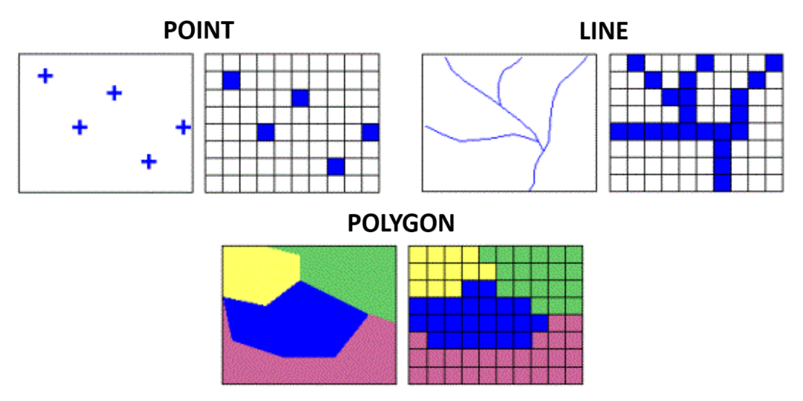
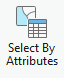
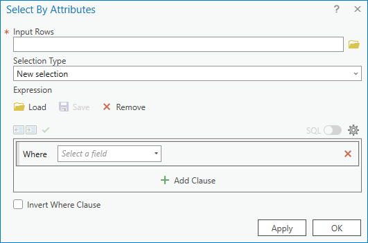
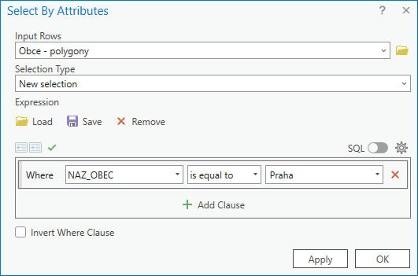
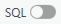
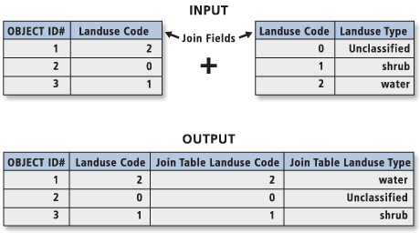
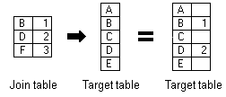
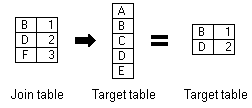

# Working with vector data: queries, joins and spatial relationships

__Spatial data__ is any type of data that directly or indirectly references a specific geographical area or location. A location can be represented not only by a combination of coordinates (X + Y, latitude + longitude, etc.), but also by, for example, an address (of arbitrary detail). The two most common data formats used to store (geo)spatial data are vector and raster.

## Spatial data types

-   :material-vector-polyline:{ .lg .middle } __Vector data__

    ---

    - represent elements of the real world using basic geometric elements: __points, lines and surfaces__ (called polygons)

    - the detail of the data is determined by the __detail of the coordinates of the vertices__ of the geometric feature

    - suitable for modelling and analysis of __discrete objects__ (e.g. location of points, land cover categories)

    - suitable for __map creation, length measurements, geometric calculations__

    - possible problems with __topology__ (gaps and overlaps)

    - basic vector data formats are __Esri Shapefile, GeoJSON, GeoPackage__ or __KML/GML__

-   :material-grid:{ .lg .middle } __Raster data__

    ---

    - represent real world elements in the form of a regular grid made up of  __pixels__ (from *picture element*)

    - the detail of the data is determined by the __spatial resolution__ of the grid, i.e. the __size__ of the __pixel__ edge (in meters)

    - suitable for modeling and analysis of __continuous phenomena__ (elevation, temperature, precipitation)
    
    - used for __image data__ (e.g. satellite imagery)

    - raster datasets can become potentially very large

    - basic raster data formats are __GeoTIFF, JPEG, PNG__ or __GIF__

<figure markdown>
  { width=600px }
  <figcaption>Difference in graphical representation of vector and raster data (Geletič et al. 2019)</figcaption>
</figure>

## Attribute queries

Attribute Query is a method of selecting/filtering elements based on __attribute values__. It complements the interactive feature selection method from practical 1. The basis is a selection rule - called __Expression__. ArcGIS Pro allows you to build expressions interactively using a dialog, but to use the full potential of expressions, it is recommended to use SQL code.
  

__Attribute query__ (over map data): _:material-tab: Map_{: .outlined} → _:material-button-cursor: Select By Attributes_{: .outlined} → fill in the dialog...
[Select features using attributes](https://pro.arcgis.com/en/pro-app/latest/help/mapping/navigation/select-features-using-attributes.htm){ .md-button .md-button--primary .button_smaller .external_link_icon target="_blank"}

{: .off-glb .process_icon}

{: .off-glb .process_icon}

{: .process_container}

<figcaption markdown>The `Input Rows` field is automatically prepopulated with the layer selected in the map content</figcaption>

Using the {: .off-glb style="vertical-align: -20%;margin:0px 5px;"} you can change the notation between the interactive dialog entry and the SQL expression.

[Introduction to query expressions](https://pro.arcgis.com/en/pro-app/latest/help/mapping/navigation/write-a-query-in-the-query-builder.htm){ .md-button .md-button--primary .button_smaller .external_link_icon target="\_blank"}
[Construct and modify queries](https://pro.arcgis.com/en/pro-app/latest/help/mapping/navigation/construct-and-modify-queries.htm){ .md-button .md-button--primary .button_smaller .external_link_icon target="\_blank"}
{: .button_array}

<!--

  
Example to try

testing attribute queries on real data

  <iframe style="filter:none !important;margin-top:.6rem;" width="100%" height="500" frameborder="0" allowfullscreen src="https://geo.fsv.cvut.cz/data/hoffmann/appqueryGISE/"></iframe>
  

  
Layer attributes scheme:

  
  

  <table>
    <tr>
      <th>attribute</th>
      <th>data type</th>
      <th>description</th>
    </tr>
    <tr>
      <td>FEATURECLA</td>
      <td><code>String</code></td>
      <td>Populated places classification</td>
    </tr>
    <tr>
      <td>NAME</td>
      <td><code>String</code></td>
      <td>Name of the populated place</td>
    </tr>
    <tr>
      <td>WORLDCITY</td>
      <td><code>Integer</code></td>
      <td>Whether the place is classified as a World city,  <code>0=no</code>, <code>1=yes</code></td>
    </tr>
    <tr>
      <td>MEGACITY</td>
      <td><code>Integer</code></td>
      <td>Whether the place is classified as a Mega city,  <code>0=no</code>, <code>1=yes</code></td>
    </tr>
    <tr>
      <td>SOV0NAME</td>
      <td><code>String</code></td>
      <td>Name of the sovereign country</td>
    </tr>
    <tr>
      <td>ADM0NAME</td>
      <td><code>String</code></td>
      <td>Name of the admin country</td>
    </tr>
    <tr>
      <td>ADM1NAME	</td>
      <td><code>String</code></td>
      <td>Name of the First-level administrative devision in a country</td>
    </tr>
    <tr>
      <td>LATITUDE</td>
      <td><code>Double</code></td>
      <td>Latitude</td>
    </tr>
    <tr>
      <td>LONGITUDE</td>
      <td><code>Double</code></td>
      <td>Longitude</td>
    </tr>
    <tr>
      <td>POP_MAX</td>
      <td><code>Double</code></td>
      <td>Estimate of inhabitants of the place <b>with</b> urban agglomeration</td>
    </tr>
    <tr>
      <td>POP_MIN</td>
      <td><code>Double</code></td>
      <td>Estimate of inhabitants of the place <b>without</b> urban agglomeration</td>
    </tr>
    <tr>
      <td>TIMEZONE</td>
      <td><code>String</code></td>
      <td>Name of the timezone</td>
    </tr>
  </table>
  

 -->

## Spatial queries

Spatial Query is a method of selecting/filtering elements of one layer based on their relative position with elements of another layer. The function uses as input the __`layer of selected elements`__, the __`layer for overlay analysis`__ a the __`relationship for overlay analysis`__.

<!-- { .off-glb .no-filter }
{ .off-glb .no-filter }
{: .process_container style="flex-wrap:wrap; row-gap: 10px;"} -->

{ .no-filter }
{ .no-filter }
{: .process_container}

 <!-- trik: vlastnosti tabulky pro vsechny podrizene -->

=== "Select POINTS..."

    === "...using POINTS"

        { style="filter:none !important;" }
        {: align=center}

        <table style="width:unset;">
            <tr><td>Intersect</td><td>A</td></tr>
            <tr><td>Intersect (DBMS)</td><td>A</td></tr>
            <tr><td>Contains</td><td>A</td></tr>
            <tr><td>Contains Clementini</td><td>A</td></tr>
            <tr><td>Within</td><td>A</td></tr>
            <tr><td>Within Clementini</td><td>A</td></tr>
            <tr><td>Are identical to</td><td>A</td></tr>
            <tr><td>Have their center in</td><td>A</td></tr>
        </table>

    === "...using LINES"

        { style="filter:none !important;" }
        {: align=center}

        <table id="small_table_padding" style="width:unset;">
            <tr><td>Intersect</td><td>A, C</td></tr>
            <tr><td>Intersect (DBMS)</td><td>A, C</td></tr>
            <tr><td>Within</td><td>A, C</td></tr>
            <tr><td>Completely within</td><td>A</td></tr>
            <tr><td>Within Clementini</td><td>A</td></tr>
            <tr><td>Have their center in</td><td>A, C</td></tr>
            <tr><td>Boundary touches</td><td>C</td></tr>
        </table>

    === "...using POLYGONS"

        { style="filter:none !important;" }
        {: align=center}

        <table id="small_table_padding" style="width:unset;">
          <tr><td>Intersect</td><td>A, C</td></tr>
          <tr><td>Intersect (DBMS)</td><td>A, C</td></tr>
          <tr><td>Within</td><td>A, C</td></tr>
          <tr><td>Completely within</td><td>A</td></tr>
          <tr><td>Within Clementini</td><td>A</td></tr>
          <tr><td>Have their center in</td><td>A, C</td></tr>
          <tr><td>Boundary touches</td><td>C</td></tr>
        </table>

=== "Select LINES..."

    === "...using POINTS"

        { style="filter:none !important;" }
        {: align=center}

        <table id="small_table_padding" style="width:unset;">
          <tr><td>Intersect</td><td>A, C, D</td></tr>
          <tr><td>Intersect (DBMS)</td><td>A, C, D</td></tr>
          <tr><td>Contains</td><td>A, C, D</td></tr>
          <tr><td>Completely contains</td><td>A, D</td></tr>
          <tr><td>Contains Clementini</td><td>A, D</td></tr>
          <tr><td>Have their center in</td><td>D</td></tr>
          <tr><td>Boundary touches</td><td>C</td></tr>
        </table>

    === "...using LINES"

        { style="filter:none !important;" }
        {: align=center}

        <table id="small_table_padding" style="width:unset;">
          <tr><td>Intersect</td><td>A, C, D, E, F, G, H, I, J</td></tr>
          <tr><td>Intersect (DBMS)</td><td>A, C, D, E, F, G, H, I, J</td></tr>
          <tr><td>Contains</td><td>G, H</td></tr>
          <tr><td>Completely contains</td><td>G</td></tr>
          <tr><td>Contains Clementini</td><td>G, H</td></tr>
          <tr><td>Within</td><td>F, H</td></tr>
          <tr><td>Completely within</td><td>F</td></tr>
          <tr><td>Within Clementini</td><td>F, H</td></tr>
          <tr><td>Are identical to</td><td>H</td></tr>
          <tr><td>Boundary touches</td><td>C, E</td></tr>
          <tr><td>Share a line segment with</td><td>F, G, H, I, J</td></tr>
        </table>

    === "...using POLYGONS"

        { style="filter:none !important;" }
        {: align=center}

        <table id="small_table_padding" style="width:unset;">
          <tr><td>Intersect</td><td>A, C, D, E, F, G, H, I, J, K, L, M, N, O</td></tr>
          <tr><td>Intersect (DBMS)</td><td>A, C, D, E, F, G, H, I, J, K, L, M, N, O</td></tr>
          <tr><td>Within</td><td>A, D, G, H, I, O</td></tr>
          <tr><td>Completely within</td><td>A</td></tr>
          <tr><td>Within Clementini</td><td>A, D, G, H, I</td></tr>
          <tr><td>Boundary touches</td><td>F, G, H, I, K, L, M, N, O</td></tr>
          <tr><td>Share a line segment with</td><td>G, I, J, K, M, O</td></tr>
          <tr><td>Crossed by the outline of</td><td>C, E, H, L, N</td></tr>
          <tr><td>Have their center in</td><td>A, C, D, E, G, H, I, J, O</td></tr>
        </table>

=== "Select POLYGONS..."

    === "...using POINTS"

        { style="filter:none !important;" }
        {: align=center}

        <table id="small_table_padding" style="width:unset;">
          <tr><td>Intersect</td><td>A, B</td></tr>
          <tr><td>Intersect (DBMS)</td><td>A, B</td></tr>
          <tr><td>Contains</td><td>A, B</td></tr>
          <tr><td>Completely contains</td><td>A</td></tr>
          <tr><td>Contains Clementini</td><td>A</td></tr>
          <tr><td>Have their center in</td><td>A, D</td></tr>
          <tr><td>Boundary touches</td><td>B</td></tr>
        </table>

    === "...using LINES"

        { style="filter:none !important;" }
        {: align=center}

        <table id="small_table_padding" style="width:unset;">
          <tr><td>Intersect</td><td>A, C, D, E, F, G, H, I, J, K, L, M, N, O</td></tr>
          <tr><td>Intersect (DBMS)</td><td>A, C, D, E, F, G, H, I, J, K, L, M, N, O</td></tr>
          <tr><td>Contains</td><td>A, D, G, H, I, O</td></tr>
          <tr><td>Completely contains</td><td>A</td></tr>
          <tr><td>Contains Clementini</td><td>A, D, G, H, I</td></tr>
          <tr><td>Boundary touches</td><td>F, G, H, I, K, L, M, N, O</td></tr>
          <tr><td>Share a line segment with</td><td>G, I, J, K, M, O</td></tr>
          <tr><td>Crossed by the outline of</td><td>C, E, H, L, N</td></tr>
          <tr><td>Have their center in</td><td>E, I, L</td></tr>
        </table>

    === "...using POLYGONS"

        { style="filter:none !important;" }
        {: align=center}

        <table id="small_table_padding" style="width:unset;">
          <tr><td>Intersect</td><td>A, C, D, E, F, G, H, I, J, K, M</td></tr>
          <tr><td>Intersect (DBMS)</td><td>A, C, D, E, F, G, H, I, J, K, M</td></tr>
          <tr><td>Contains</td><td>C, E, H, M</td></tr>
          <tr><td>Completely contains</td><td>C</td></tr>
          <tr><td>Contains Clementini</td><td>C, E, H, M</td></tr>
          <tr><td>Within</td><td>F, G, H, M</td></tr>
          <tr><td>Completely within</td><td>F</td></tr>
          <tr><td>Within Clementini</td><td>F, G, H, M</td></tr>
          <tr><td>Are identical to</td><td>H, M</td></tr>
          <tr><td>Boundary touches</td><td>D, E, G, H, I, J, M</td></tr>
          <tr><td>Share a line segment with</td><td>D, H, I, M</td></tr>
          <tr><td>Crossed by the outline of</td><td>A, E, G, J, K</td></tr>
          <tr><td>Have their center in</td><td>C, E, F, G, H, K, L</td></tr>
        </table>
        

<!-- <figcaption markdown>zdroj: [Select By Location graphic examples](https://pro.arcgis.com/en/pro-app/latest/tool-reference/data-management/select-by-location-graphical-examples.htm)</figcaption> -->

__Resources:__
{: align=center }
[:material-open-in-new: Select features by location](https://pro.arcgis.com/en/pro-app/latest/help/mapping/navigation/select-features-by-location.htm){ .md-button .md-button--primary .button_smaller target="\_blank"}
[:material-open-in-new: Select Layer By Location (Data Management)](https://pro.arcgis.com/en/pro-app/latest/tool-reference/data-management/select-layer-by-location.htm){ .md-button .md-button--primary .button_smaller target="\_blank"}
[:material-open-in-new: Select By Location graphic examples](https://pro.arcgis.com/en/pro-app/latest/tool-reference/data-management/select-by-location-graphical-examples.htm){ .md-button .md-button--primary .button_smaller target="\_blank"}
{: align=center style="display:flex; justify-content:center; align-items:center; column-gap:20px; row-gap:10px; flex-wrap:wrap;"}

## Attribute and spatial join

Through a common field, known as a <strong>key</strong>, you can associate records in one table with records in another table. For example, you can associate a table of parcel ownership information with the parcels layer, because they share a parcel identification field. You can make these associations in several ways. Joins can also be based on spatial location.

Joins information are stored in the layer's properties, so they can be applied only to tables that are opened from a map or scene. To access join information, right-click the layer and click *Properties* to open the *Layer Properties* dialog box, and click the *Joins* tab.

### Join the attributes from a table
Typically, you'll join a table of data to a layer based on the value of a field that can be found in both tables. The name of the field does not have to be the same, but the data type must be the same; you join numbers to numbers, strings to strings, and so on. You can perform a join using the *Add Join* geoprocessing tool. When performing an attribute join, the joined fields are dynamically added to the existing table. Field properties (such as aliases, visibility, and number formatting) are maintained when a join is added or removed.

{ .no-filter .off-glb}
{: align=center}

!!! note-grey "Note"

    When joining tables, the default option is to **keep all records**. If a record in the target table doesn't have a match in the join table, that record is given null values for all the fields being appended into the target table from the join table.

    { .no-filter .off-glb}
    {: align=center}

    With the **keep only matching records** option, if a record in the target table doesn't have a match in the join table, that record is removed from the resultant target table. If the target table is the attribute table of a layer, features that don't have data joined to them are not shown on the map.

    { .no-filter .off-glb}
    {: align=center}

### Join data by location spatially
When the layers on your map don't share a common attribute field, you can join them using the *Spatial Join* geoprocessing tool, which joins the attributes of two layers based on the location of the features in the layers.

With a spatial join, you can complete any of the following common workflows:

* Find the nearest feature
* Find what is inside a polygon
* Find what intersects a feature

Join by location, or spatial join, uses spatial associations between the layers involved to append fields from one layer to another. Depending on the type of association, you can append the attributes or an aggregate (minimum, maximum, mean, and so on) of numeric attributes from a matched feature to the target features. Spatial joins by default are different from attribute-driven joins in that they are **not dynamic** and require you to save the results to a new output layer.

__Resources:__
{: align=center }

[pro.arcgis.com Join the attributes from a table](https://pro.arcgis.com/en/pro-app/latest/help/data/tables/joins-and-relates.htm#GUID-39C9610A-6A73-4985-ADB8-7354EA9DB8BF){ .md-button .md-button--primary .server_name .external_link_icon_small target="_blank"}
[pro.arcgis.com Join data by location (spatially)](https://pro.arcgis.com/en/pro-app/latest/help/data/tables/joins-and-relates.htm#GUID-7B11EAA4-35E0-4B8D-AFB6-4A435761574B){ .md-button .md-button--primary .server_name .external_link_icon_small target="_blank"}
[learn.arcgis.com Remove join](https://pro.arcgis.com/en/pro-app/latest/help/data/tables/joins-and-relates.htm#ESRI_SECTION1_6507320BCB1E45219A88F1AA0A24F7B9){ .md-button .md-button--primary .server_name .external_link_icon_small target="_blank"}
{: .button_array}

## Assignment 02
!!! abstract "Exploring European regions"
    **TASK:**

    Explore statistical data of the NUTS 2 regions in your country using attribute and spatial queries.

    1. **Create a thematic geodatabase** named `YourSurname_CountryName_as03.gdb` **containing the following layers / tables**:

        - **a polygon layer of NUTS 2 regions located within your selected country**
          (**Required attributes:** NUTS 2 ID, NUTS 2 name, country code, population, population category, unemployment rate, unemployment rate category, GDP, GDP category, number of airports, airport density (airports per km²), area, area category)
        - **a polygon layer of NUTS 2 regions neighbouring your selected country**
          (**Required attributes:** NUTS 2 ID, NUTS 2 name, country code, population, population category, unemployment rate, unemployment rate category, GDP, GDP category, number of airports, airport density (airports per km²), area, area category)
        - **a point layer of airports located within your selected country**
          (**Required attributes:** ID, type, name, lat_deg, long_deg, elevation_ft, country ID, NUTS 2 ID, NUTS 2 name)
        - **a point layer of airports located within 100 km of the borders of your selected country**
          (**Required attributes:** ID, type, name, lat_deg, long_deg, elevation_ft, country ID, NUTS 2 ID, NUTS 2 name)
        - **a table summarising the following numerical information about NUTS 2 regions for individual EU countries** *(region names do not need to be included!)*:
          count, min_area, max_area, avg_area, min_pop, max_pop, avg_pop, min_ur, max_ur, avg_ur, min_gdp, max_gdp, avg_gdp)

    
    2. **Create a map poster** in A3 format named `YourSurname_CountryName_as03.pdf` **containing**:

        - **A map showing airports located within your selected country.** Airports must be distinguished by colour according to their type (small / medium / large). Use shaded relief and NUTS 2 region boundaries as the map background.
        - **A map showing one selected statistical indicator (unemployment rate / GDP per capita) **using an areal mapping method. Use two colours to distinguish NUTS 2 regions according to whether the value of the selected indicator is above or below the EU average.
        - **A text section containing written answers / comments on the following questions** related to the maps:

              - map of airports:

                    - How many airports are located within your selected country?
                    - How many airports are located within 100 km of the country border?
                    - List the names of the NUTS 2 regions within your country with the highest and lowest airport density.

              - map of selected statistical indicator (unemployment rate / GDP per capita)_

                    - How many NUTS 2 regions border your selected country? Which countries do these regions belong to?
                    - List the names of the NUTS 2 regions within your country with the highest and lowest values of the selected indicator.

     
    **DATA SOURCES:**
    
      [:material-download: DATA :material-layers:](../assets/cviceni3/GISE_ex03_data.zip){ .md-button .md-button--primary .button_smaller }
        {: .button_array style="justify-content:flex-start;"}
    
    **SUBMISSION FORM:**

    - gdb + map poster in PDF (submit by 01/11, send to <a href="mailto:petra.justova@fsv.cvut.cz">petra.justova@fsv.cvut.cz</a>)

    
    **INSTRUCTIONS:**

    1. Add the `NUTS_RG_03M_2024_4326_LEVL_2.shp` layer to the map and explore the contents of its attribute table.

    2. Join the data from `NUTS2_statistics.csv` to the NUTS 2 regions layer (*Add Join*). Export the layer with the joined data as a new feature layer with an appropriate name, for example `NUTS02_statistics` (*Data → Export Features*).

    3. In the new `NUTS02_statistics` layer, create four new text fields:

        - `pop_cat` – population category
        - `ur_cat` – unemployment rate category
        - `GDP_cat` – GDP category
        - `area_cat` – area category

        For each NUTS 2 region, assign either `"above avg"` or `"below avg"` depending on whether the value of the corresponding indicator is above or below the mean value for all NUTS 2 regions in the EU. (*Add Field*, *Select By Attributes*, and *Calculate Field*)

    4. Create a summary table for individual EU countries containing the minimum, maximum, and average values of the following statistical indicators (*Attribute Table → Summarize*):

        - population
        - unemployment rate
        - GDP per capita
        - area

    5. From the `NUTS02_statistics` layer, select only the NUTS 2 regions belonging to your selected country using (*Select By Attributes*). Export the selected features to a new layer (*Data → Export Features*).

    6. Add the airport data from `eu-airports_filtered.csv` to the map (*XY Table To Point*).

    7. From the airport layer, use *Select By Location* to select:

        - all airports located within your selected country;
        - all airports located within 100 km of the border of your selected country (excluding airports located inside your country!)

        Export both spatial selections as separate point layers (*Data → Export Features*).

        Then use *Spatial Join* to add the NUTS 2 region name and NUTS 2 ID to both airport layers according to the region in which each airport is located.

    8. From the `NUTS02_statistics` layer containing the NUTS 2 regions of all EU countries, use *Select By Location* to select the NUTS 2 regions that border your selected country.

        Export the spatial selection as a separate polygon layer using (*Data → Export Features*).

    9. For both the NUTS 2 regions within your selected country and the neighbouring NUTS 2 regions, use *Spatial Join* to calculate the number of airports located in each region (*Spatial Join → New Field → Count*). Then add and calculate a new attribute representing airport density (number of airports per km²).

    10. Create an A3 map poster according to the assignment requirements. Choose portrait or landscape orientation depending on the shape and extent of your selected country.

    
<!--    - Join
        1. Download prepared data, which include a geodatabase and a shapefile. Connect the geodatabase to your project and add country polygon feature layer and country table to the map.
        2. Join data from table to data in polygon feature layer. *(Add Join)*
    - Attribute Query
        1. Add Rivers layer from geodatabase
        2. Choose one river that flows through at least two countries.
        3. Remove all other rivers (Select by Attributes)
    - Spatial Query
        1. Select all the countries through which this river passes. (Select by Location)
        2. Delete all other countries. (Select by Location)
        3. Add Cities layer from geodatabase.
        4. Select all cities in your countries. (Select by Location)
        5. Delete all other cities. (Select by Location)
    - Spatial Join
        1. Join Name from countries into cities. (Spatioal Join)
    - Share Data
        1. Save data as Shapefile (Feature Class To Shapefile)
        2. Make ZIP file with data -->

__Supplemental exercise:__
{: align=center }

[learn.arcgis.com Join tabular data to a spatial layer](https://learn.arcgis.com/en/projects/join-tabular-data-to-a-spatial-layer/){ .md-button .md-button--primary .server_name .external_link_icon_small target="_blank"}
{: align=center}

